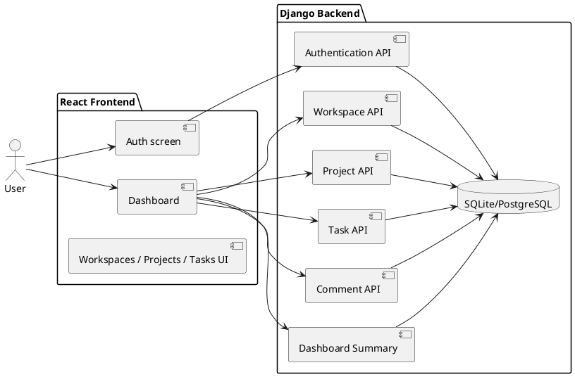

# TaskFlow Architecture View

The architecture follows the documented modular monolith design: a React SPA talks to a DRF API layer, which persists state in PostgreSQL (or SQLite for local development), with workspace-scoped authorization enforced on the backend.
